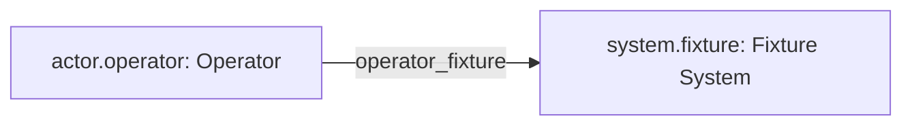
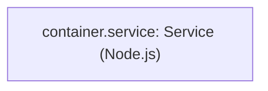
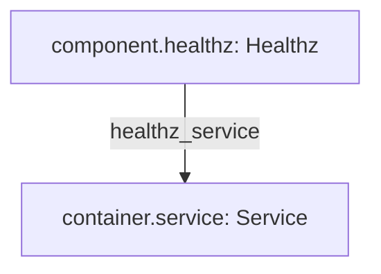

# Health Endpoint Specification

## Narrative

This specification defines a minimal health endpoint for the fixture service. An operator
calls the fixture system, which hosts a Node.js service exposing a `healthz` component.
The service must respond to `GET /healthz` with a status of `ok`.

## Views

### Context view

Source: [diagrams/context.mmd](diagrams/context.mmd)

### Containers view

Source: [diagrams/containers.mmd](diagrams/containers.mmd)

### Components view

Source: [diagrams/components.mmd](diagrams/components.mmd)

## Requirements

- **req.healthz** (must): When called, the service shall return its health status.
  - Acceptance **check.healthz**: GET /healthz returns status ok.

## Implementation tasks

- Coder task: add the `/healthz` endpoint and a test verifying `GET /healthz` returns status `ok`.
- Tester gate: explicit gate — tests must pass before release.
- Security gate: explicit gate — security review must pass before release.