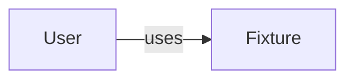
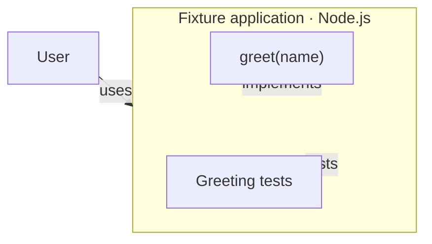

# Live greeting acceptance specification

This page is the human-readable narrative for
[`spec.live@5`](spec.yaml). The machine-readable specification remains the
source of truth; these diagrams are views of it.

## Problem

The test fixture has no feature code. Add a small `greet(name)` function and
cover it with a unit test so the fixture exercises the full Swarm acceptance
flow.

## Scope

- Add `greet(name)` to the fixture application.
- Return `Hello, ${name}!`.
- Cover `greet('World')` with a Node test.
- Keep the existing `npm test` command working.
- Do not add a user interface or unrelated behavior.

## Context

The user calls the fixture application.

The source is [`diagrams/context.mmd`](diagrams/context.mmd) and the view is
`view.context`.

## Containers and components

The fixture application is a Node.js container. It contains the greeting
function and its test component.

The container source is [`diagrams/containers.dsl`](diagrams/containers.dsl);
the component source is [`diagrams/components.dsl`](diagrams/components.dsl).
They map to `view.containers` and `view.components`.

## Requirement

| ID | Priority | Statement |
| --- | --- | --- |
| `req.greet` | must | When a name is supplied, the fixture shall return a personalized greeting. |

Traceability:

- `req.greet` traces to `actor.user`, `view.context` and `component.greet`.
- `component.test` verifies the greeting through `npm test`.
- `dec.tests` records the decision to use the fixture's existing test runner.

### Acceptance

Given the name `World`, `greet` returns `Hello, World!`.

The executed acceptance result is recorded in
[`ACCEPTANCE.md`](../../ACCEPTANCE.md).
